# wth-edge-device

The Watch The Hutch edge device: a Raspberry Pi at a window that watches the bridge and
river, shows its status on a small round screen, and (soon) publishes bridge state to the
[web app](https://github.com/Jonathanferreras/watch-the-hutch-web).

This is **v2**, built to be redeployed onto any Pi from a fresh SD card. Hardware is
described by a profile, calibration by a site file, and everything runs as systemd
services. The Pi 3 version lives in [`legacy/`](legacy/) until v2 replaces it.

## Bring up a new Pi

1. Flash **Raspberry Pi OS Lite (64-bit)** with Raspberry Pi Imager. In its settings set
   the hostname, user, Wi-Fi and your SSH key.
2. Clone and install:

   ```sh
   sudo apt update && sudo apt install -y git   # Pi OS Lite has no git
   sudo git clone https://github.com/Jonathanferreras/wth-edge-device /opt/wth-edge
   sudo /opt/wth-edge/install.sh --profile pi5-cam3-gc9a01 --device-id hutch-01
   ```

3. If the installer says SPI was just enabled, `sudo reboot`.
4. Open the web panel at `http://<hostname>.local:8080`. The installer prints the login
   (`wth` / a generated password kept in `/etc/wth/secrets.env`).

`install.sh` is safe to run again. To update later: `sudo wth-edge update` (git pull +
reinstall). To remove: `sudo /opt/wth-edge/uninstall.sh` (add `--purge` to delete config
and data too).

## What runs

| Unit | Command | Does |
| --- | --- | --- |
| `wth-edge.service` | `wth-edge run` | Owns the camera (Picamera2), records clips, collects telemetry, writes `/run/wth/state.json`, serves the web panel on port 8080, hands data to the publisher. |
| `wth-display.service` | `wth-edge display` | Plays the boot animation, then draws the round GC9A01 screen from `state.json`: the live pixel art scene, the text status, or both in turn (`display.mode`). Separate on purpose: it shows **OFFLINE** when the main app is down. |

Useful commands on the Pi:

```sh
wth-edge doctor                 # checks camera, SPI, power, services, web panel
journalctl -u wth-edge -f       # logs
systemctl restart wth-edge
wth-edge config                 # the merged config as JSON
```

## Configuration

Layers, later ones win: code defaults → `profiles/<profile>.toml` → `sites/<site>.toml` →
`/etc/wth/device.toml` → `/var/lib/wth/rois.toml` (boxes saved from the web panel; delete it
to go back to the site file).

| File | Holds | In git |
| --- | --- | --- |
| `profiles/*.toml` | Hardware: camera model and resolution, screen driver and pins, which services run | yes |
| `sites/*.toml` | One window's calibration: ROIs as fractions of the frame, compass directions | yes |
| `/etc/wth/device.toml` | This Pi's id, profile, site, and any local overrides | no |
| `/etc/wth/secrets.env` | `WTH_WEB_PASSWORD` and, later, backend credentials | no |

Profiles today:

- `pi5-cam3-gc9a01`: Pi 5, Camera Module 3 NoIR, GC9A01 screen (DC GPIO 25, RST GPIO 27, CE0).
- `pi3-cam2-headless`: the original Pi 3 with no screen (greyscale preview).
- `dev`: a laptop, with a synthetic camera and the screen written to a PNG.

## Detectors, the opening state machine and auto-recording

`wth-edge run` watches the boxes in the live view about 5 times a second:

- **Leaves** (`bridge` = the near leaf, `far_leaf` = the far one): the longest straight
  edge in each box (Canny + Hough, ported from the old `bridge.py`) gives the leaf angle,
  0° flat to 90° upright. A 3 s median and a 2 s hold turn it into `closed` / `opening` /
  `open` / `closing` / `unknown` per leaf. The leaves lift one at a time, far leaf first,
  so the far box is the earlier signal. Both read the full-resolution greyscale frame.
- **Traffic** (`northbound`, `southbound`, `deck`): two cheap measures on the preview
  frame per box. *Flow* is how much of the box changed since the last frame (cars moving);
  *fill* is how much differs from a slowly learned background (cars present, moving or
  not). Each lane gets the web app's level: `light` / `moderate` / `heavy` from the fill
  while traffic moves, `standstill` when the lane is filled and nothing moves for 8 s. The
  deck only reports clear or busy: clear when both lanes are at a standstill, or when no
  car has crossed it (no movement, no moving car box) for 5 s (`deck_clear_s`). The panel shows live flow and fill per lane so the
  thresholds in `[traffic_detector]` can be tuned on the real view.
- **Boats** (`boat`, plus `boat_near` for the river close to the camera; each box has its
  own motion gate; the model runs on the boxes that just moved or hold the crossing, and
  takes them in turn when nothing moves, so two boxes cost about what one did; the best
  sighting feeds one crossing tracker):
  background subtraction in the boat boxes wakes YOLOv8s (`models/yolov8s.onnx`,
  COCO class `boat`, run through OpenCV, no PyTorch). The model also runs every 2 s when
  nothing moves, because a slow tug blends into the background. Two hits start a
  crossing; the direction locks once the boat has moved 3% of the frame width; the
  crossing ends 20 s after the last hit.
- **AIS** (optional, `[ais] enabled = true`): vessel positions from aisstream.io for a
  1-mile box around the bridge (`site.bridge_lat` / `bridge_lon`, key in
  `WTH_AISSTREAM_KEY`). Each vessel gets its side of the bridge, whether it is closing on
  it and an ETA. The panel plots them on a map; `wth-edge ais` prints them in a terminal.
  A local RTL-SDR receiver can feed the same table later.

### Stages: what gets looked at when

The detectors don't all run all the time. `wth_edge/detectors/stages.py` picks what to
measure, starting from traffic, which is the cheapest and earliest sign of an opening:

```
traffic --(no lane moving 15 s)--> watch --(a leaf moving or up)--> track
   ^                                 |  ^                              |
   +--(cars moving 5 s, or no leaf --+  +----(all leaves flat 15 s)-----+
       movement for 30 s)
```

1. **traffic**: only the lane and deck boxes. Once neither direction has moved for 15 s
   (or the lanes can't be read), the device starts watching the bridge.
2. **watch**: the leaves and the boat model too. A leaf opening (or already up) moves on
   to `track`. Cars moving again, or 30 s without leaf movement, goes back to `traffic`,
   so a red light or a crash bounces between the two. A boat (camera or AIS) keeps the
   watch going until 2 minutes after the last sighting.
   A leaf reading only counts while no car is moving.
3. **track**: the bridge is moving. Leaves every frame and the boat model at its full
   rate, so the boat's path is followed while it is in view. All leaves flat for 15 s goes
   back to `watch`, and from there cars moving goes back to `traffic`.

Traffic flowing in both directions for 5 s ends `track` whatever the leaves read: a pole
in a leaf box can look like a raised leaf, but cars can't cross an open bridge. The opening
state machine follows the same rule: a leaf reading never starts an opening while either
direction flows, and both directions flowing ends one.

Without lane boxes there is nothing to gate on, so the pipeline stays in `watch`/`track`.
In `traffic` the leaves are not measured; their state reads `closed` with `assumed: true`,
since flowing traffic means the bridge is down.
The boat motion gate keeps learning the river in every stage (it is cheap) so the watch
doesn't start on a stale background; boats under a closed bridge with traffic flowing
are not tracked. All times are in `[stages]`; `enabled = false` runs every detector on
every frame as before (handy for `wth-edge eval` on boat-only clips). The panel shows the
stage, why it was entered and the countdown back to `traffic`.

### The state machine

`wth_edge/opening.py` turns those signals into one phase, following the design doc
"Bridge opening state machine":

```
flowing -> gates_down -> lifting -> raised -> lowering -> releasing -> flowing
```

- `gates_down`: both directions at a standstill with the deck clear for 20 s. Stopped
  traffic starts the clock; a boat (camera or AIS) or a leaf rising confirms it. With
  neither for 3 minutes, or traffic moving again, it was an accident or a light and the
  phase goes back to `flowing`. A boat on its own never starts an opening: most boats in
  the old dataset pass under the closed bridge.
- `lifting` / `lowering` follow the leaf trackers; `raised` needs every visible leaf up and
  steady. A tug often passes while the near leaf is still rising, so `lifting` straight to
  `lowering` is normal.
- `releasing`: leaves flat, the queue clearing (`heavy` for a minute); `flowing` after 10 s
  of movement.
- `unknown` after 30 s with no readable signal.

Each phase maps to the website's fields with its invariants built in: `position`
(`closed` / `opening` / `open` / `closing` / `unknown`), traffic per direction (`standstill`
whenever the bridge is not closed) and `estimatedWaitTime` (only while opening, open or
closing). The wait is the median of past openings per phase, from
`<data_dir>/openings.json`, with the defaults in `[opening]` until the device has seen a
few. The publisher sends those fields out as described in
[Publishing to Firestore](#publishing-to-firestore).

The camera sees boats approaching from the east well and from the west barely
(`site.approach_sides`), so a missing boat on the blind side never counts against an
opening; AIS covers that side.

### Auto-recording

When the phase leaves `flowing` (gates down, so the run-up is in the clip) or a boat
crossing starts, a clip starts by itself (trigger `bridge` or `boat`, with the usual 15 s
pre-roll) and stops 20 s after both are quiet. Pressing **Stop** on an automatic clip
sticks until the scene goes quiet. While any clip records, the detectors write a log into
its `clip.json` (`detections`: leaf angles and positions, lane levels with flow and fill,
deck, phase, the boat box and direction, the nearest AIS vessel, once a second, plus each
event), to use as draft labels. Events also go to the publisher.

Settings: `[detectors]`, `[bridge_detector]`, `[traffic_detector]`, `[boat_detector]`,
`[opening]`, `[ais]`, `[weather]`, `[autorecord]`, `[tune]` (see `wth_edge/config.py` for every knob).

### Checking the detectors against recorded clips

```sh
wth-edge --config dev/device.toml eval ~/wth-clips --label boat --out ~/wth-eval.json
```

`eval` replays every clip in a clip store through the same detector code at the live
rate and prints, per clip, the crossings and directions found against the folder labels,
the bridge positions seen and the angle range. Clips without their own ROIs (the imported
Pi 3 set) use `sites/legacy-pi3.toml`; `--site` picks another.

What it showed on the 12 old clips: the tug on 2026-04-11 was found with the right
direction and no false alarms on the two traffic clips, but 7 of the 9 "boat" clips are
small boats passing under the closed bridge, so per-clip recall is not a useful number for
that set. Only 03-18 and 04-11 hold an opening, both starting with the far leaf already up.
The bridge angle is reliable in clear light and unreliable in fog, at night and where the
old camera was zoomed differently. The state machine stays in `flowing` on every clip
(no false gates-down), but the old clips are too short to learn a lane's background, so
the traffic levels there are only indicative. Clips recorded by v2 carry their own ROIs in
`clip.json`, so `eval` on those is the real benchmark.

### Self-tuning

The **Self-tune** switch on the panel runs the loop `wth_edge/tune/` implements: record,
check what the detector said against what was really there, tune, report, delete the video.

1. **Record** for the time picked next to the switch (1 hour by default, `[tune] duration_s`)
   in 5-minute chunks (`chunk_s`), as ordinary clips with trigger `tune`. The live detector
   runs as usual and logs its readings into each chunk. Auto-recording stands aside.
2. **Review**, while the next chunk records, at low priority:
   - the reference pass runs the YOLO model over the lanes 2 times a second and the river
     every 2 s, and counts cars per direction and boat crossings;
   - every 15 s, and wherever the detector's reading changed, it saves two frames 2 s apart
     with the boxes drawn on. Claude labels each lane (empty, moving, stopped, and how
     full), the deck (clear or cars), the leaves (down or raised) and boats.
3. **Tune.** It scores the detector's log against the labels, fits `flow_min`,
   `present_min`, `moderate_min`, `heavy_min`, `deck_clear_max` and the leaf angles to them
   (at most halving or doubling a value per round), and replays the recording with the old
   and the new settings. New settings are kept only if the replay improves by `min_gain`.
   They apply at once and go to `<data_dir>/tuning.toml`; **Reset tuning** on the panel (or
   deleting that file and restarting) undoes them.
4. **Report** under **Self-tune reports**: cars each way, boats (reference vs detector),
   openings, standstills, accuracy per signal, the settings changed, and the frames where
   the detector and Claude disagreed. The recorded video is then deleted
   (`keep_footage = true` keeps it); only those frames stay.

While accuracy is under `target_accuracy` (90%) and the last round's changes helped, it
records another round, up to `max_rounds` (3). Turning the switch off while recording
ends the recording and still analyses what was recorded; turning it off during the
analysis abandons it. A restart mid-round marks the round interrupted and deletes its video.

Why 5-minute chunks: each one is reviewed while the next records, so the report is ready
soon after the hour; a crash loses at most 5 minutes; and the replay stitches the chunks
back into one timeline, so an opening across a chunk boundary still reads as one.

**Who reviews:** Claude Code on the Pi, logged in as you. The service can't use your login
(it runs as `wth`), so the two meet in a queue folder, `/var/lib/wth/tune/queue`: the
service drops each chunk's frame pairs there, and `wth-tune-review.timer` runs
`wth-edge tune-review` as you every 2 minutes. That runs `claude -p` on 12 moments at a time
(it reads the frames with its Read tool and answers in a fixed JSON shape) and writes the
labels back. install.sh sets the timer up for the user who ran `sudo` (`--review-user NAME`
for another) and adds that user to group `wth`. Claude Code has to be installed and logged
in for that user (`claude` once in a terminal). It counts against your Claude plan's usage:
an hour is up to 360 moments, about 30 runs. If the plan's limit is hit, the rest waits for
the next run; after `review_wait_s` (3 h) the round goes on with what was labelled.
The panel says whether the timer is alive. To check by hand:

```sh
systemctl list-timers wth-tune-review.timer
journalctl -u wth-tune-review.service --since "1 hour ago"
wth-edge tune-review        # one run now, as yourself
```

`[tune] reviewer = "api"` uses the Anthropic API from the service instead (needs
`ANTHROPIC_API_KEY` in `/etc/wth/secrets.env` and `sudo /opt/wth-edge/.venv/bin/pip install anthropic`, billed per token); `"none"` records, counts
and reports without tuning. Self-tuning needs recording to be on and about 2 GB free for an
hour of video.

## Publishing to Firestore

With `[publisher] driver = "firestore"` the Pi writes straight to the web app's Firestore, so
the website follows the camera. What it writes:

| Document | When | Holds |
| --- | --- | --- |
| `bridgeState/current` | A new position at once; a new traffic level once it has held 60 s (`traffic_hold_s`); the unchanged state every 10 min (`heartbeat_s`) | The website fields with `sourceType: "device"`, `sourceId` = the device id, server `updatedAt` |
| `events/{id}` | Each change of position or traffic | The same shape the admin form writes |
| `deviceEvents/{id}` | Phase changes and boat crossings | The state machine event |
| `devices/{id}` | Every `interval_s` (300 in the Pi profiles) | Telemetry and a server `lastSeenAt` |

Confidences and the wait countdown never cause a write on their own (the website counts down
from `startedAt` itself), because every write to `bridgeState/current` also costs one read
per open browser tab. Expect a few hundred writes a day against Firestore's free 20,000.

**Admin override.** When an admin saves a state from the website's dashboard it sets
`acceptsDeviceUpdates` to `false`. The Pi then stops writing `bridgeState/current` (events
and telemetry still go), checks again every `override_check_s` (60), and resumes with its
latest state once the dashboard's **Hand back to device** sets it to `true`.

**Not trusted yet?** `withhold = ["traffic"]` (or `"wait"`, `"position"`) sends that field as
unknown until its detector passes the accuracy gate.

Writes go through one background thread, so a slow network never stalls the detectors. When
Firestore or the Wi-Fi is down it keeps the latest state, telemetry and up to 500 events and
retries with a backoff of up to 5 minutes. The panel's telemetry card shows the publisher's
health, the override and today's write count.

Set it up:

1. Firebase console > Project settings > Service accounts > **Generate new private key**.
2. Copy the JSON to the Pi and lock it down:

   ```sh
   scp key.json pi@hutch.local:/tmp/
   sudo mv /tmp/key.json /etc/wth/firebase-service-account.json
   sudo chown root:wth /etc/wth/firebase-service-account.json && sudo chmod 0640 /etc/wth/firebase-service-account.json
   ```

3. Add to `/etc/wth/device.toml`, then `sudo systemctl restart wth-edge`:

   ```toml
   [publisher]
   driver = "firestore"
   ```

4. `wth-edge doctor` reads `bridgeState/current` once to check the key and project.

The service account bypasses Firestore security rules, so the rules (in the web app's
`firestore.rules`) can keep the browser read-only for everyone but signed-in admins.

## Recording clips

The web panel has a **Recording** card: pick a label, add a note, press Start. Each clip
begins up to 15 s *before* you press Start (a pre-roll buffer) and stops itself after 10
minutes. Clips land in `/var/lib/wth/clips/YYYY-MM-DD/` as three files:

| File | Holds |
| --- | --- |
| `<id>.mp4` | 1280x720 H.264 from the main stream (Pi 5 encodes in software with libav) |
| `<id>.json` | When, why (`trigger`), label, note, keep flag, camera, the ROIs at the time, and (from phase 3) a per-frame detection log for draft labels |
| `<id>.jpg` | Thumbnail for the clip browser |

The **Clips** section plays, downloads, keeps (★) and deletes clips. When free disk drops
below 20%, the oldest clips that aren't kept are deleted. Settings live in `[recording]`
(`prebuffer_s`, `max_duration_s`, `bitrate`, `min_free_percent`, `labels`).

**Adjust boxes** in the live view lets you drag every box (move or resize from a corner)
and saves them to `rois.toml` on the Pi. The boxes are `bridge` (near leaf), `far_leaf`,
`boat`, `northbound` and `southbound` (the approach lanes up to their gates), and `deck`.

Above the feed there's a tab for every box in the site config (new boxes show up on their
own). A box's tab shows that box zoomed in, cut from the full-resolution frame, next to the
full view with just that box drawn, plus what its detector reads right now. The same crop is
at `/roi/<name>.jpg`, and `stream.mjpg?roi=<name>` streams it.

**Boxes** and **Detections** on the feed toggle separately. Detections are the leaf lines,
the lane levels, a box around each car the lane detector sees (white moving, amber stopped)
and the boat (red). Car boxes are blobs of "not road" in the lane and deck boxes rather than
a car model, so a tight queue can show as one box; tune them in `[traffic_detector]`
(`vehicle_min_area`, `vehicle_max`, or `vehicle_boxes = false`).

### Import the old dataset

The clips from `wth-inference-training/dataset` can be brought into the same layout, so
training code reads one format. Folder names become metadata (label from the top folder,
`e2w`/`w2e` direction, `bad_footage`, and `boat_details.json`). Imported clips are marked
keep. It is safe to run again.

```sh
wth-edge --config dev/device.toml import-dataset ~/wth-inference-training/dataset --data-dir ~/wth-clips --dry-run
wth-edge --config dev/device.toml import-dataset ~/wth-inference-training/dataset --data-dir ~/wth-clips --link
```

`--link` symlinks instead of copying the 8 GB of video.

## Develop on a laptop

```sh
python3 -m venv .venv && . .venv/bin/activate
pip install -e '.[dev]'
wth-edge --config dev/device.toml run       # web panel on http://127.0.0.1:8080
wth-edge --config dev/device.toml display   # screen frames go to dev/display.png
pytest
```

To replay a recorded clip instead of the test pattern (it loops):

```sh
pip install -e '.[replay]'
wth-edge --config dev/device.toml run --source ~/wth-clips/clips/2026-04-03/<id>.mp4
```

Or set `driver = "file"` and `file_path` under `[camera]` in `dev/device.toml`. Recording
works on a laptop too: it encodes the 640x360 preview frames with PyAV.

## Pixel art on the round screen

Retro pixel art lives in `wth_edge/display/art/`: a small drawing kit (`kit.py`: one palette
with the muted teals and neons, ASCII sprites, a 3x5 pixel font, Bayer dithering, the round
mask), the lofi canal scene (`lofi.py`), the bundled animations built from it (`scenes.py`)
and a player (`player.py`). The scene is drawn on a 120x120 canvas and scaled 2x to the
240x240 panel, with CRT scanlines. The built GIFs in `wth_edge/display/art/gifs/` are both the
previews and what the Pi plays.

The cast: **Officer Garrison**, a mallard in a cyan visor and a long shearling-collared coat,
leans on the fender of a patrol car on the right and keeps watch. **Eugene**, a plain mallard,
drifts in the canal on the left, dabbles, shouts "!" when a boat comes through and sleeps
with a Zzz at night. Between them, centre stage, the drawbridge with its gate arms, warning
lamp and the traffic crossing it, under a teal skyline of lit windows and neon signs.

| boot | idle | alert | sleep |
| --- | --- | --- | --- |
| 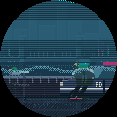 | 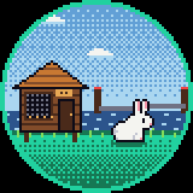 | 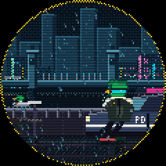 |  |

```sh
wth-edge art list                       # bundled animations
wth-edge art build [idle ...]           # redraw the GIFs after editing lofi.py or scenes.py
sudo systemctl stop wth-display         # the player and the status screen share the SPI bus
wth-edge play idle --seconds 30         # any bundled name, a .gif, or a folder of PNG frames
sudo systemctl start wth-display
```

### Telemetry in the art

With `display.mode = "art"` (or `"alternate"`, the default: 20 s of art, then 6 s of the text
status screen, set by `art_s` and `status_s`) the screen draws the canal live at `art_fps` (8)
from `state.json`, with the device state drawn into it (`art/live.py` turns the state into the
scene's look, `art/lofi.py` draws it):

| Shows | Means |
| --- | --- |
| ring colour | overall status: cyan ok, amber degraded, red offline, lavender starting |
| drawbridge up or down, lamp flashing | `bridge.position` (or the opening state machine's), eased while it moves |
| `WAIT 4M` above the bridge | the state machine's remaining minutes, only while opening, open or closing |
| cars crossing, more of them as traffic builds | `traffic.<lane>.level` light / moderate / heavy while the bridge is closed |
| cars queued at the gate arms | the bridge isn't closed, so traffic is at a standstill (the web app's rule) |
| an empty bridge | traffic unknown |
| boat crossing, Eugene under a "!" | a boat is detected, in its direction (`w2e` sails left to right) |
| visor cyan / red X / amber tick / scanning bar | camera ok / camera down / CPU above 72 °C / visibility too low |
| drizzle, downpour, fog bank, snow, lightning | `weather` (see below) |
| city browning out and stuttering | under-voltage right now |
| city dark, red caption | offline (no state update) |
| red dot | recording |
| both ducks asleep, dim city, Zzz | `night_hours` (22 to 6), unless something is happening |
| caption strip at the bottom | one reading at a time: temperature, volts, fps, warnings, boat, bridge, weather, REC |

| ok | boat, bridge open, recording | heavy traffic | hot and low power |
| --- | --- | --- | --- |
|  | 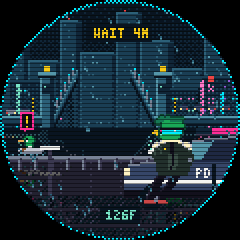 | 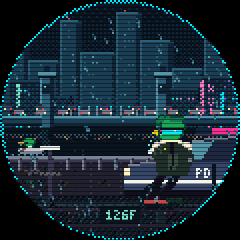 | 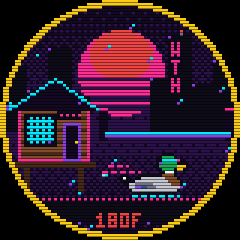 |
| **camera down** | **fog, visibility 600 m** | **downpour** | **snow** |
| 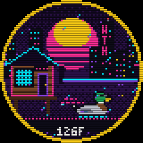 | 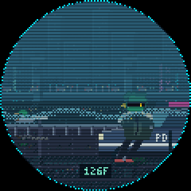 | 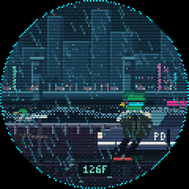 | 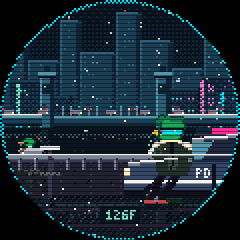 |
| **thunderstorm** | **night** | **offline** | |
| 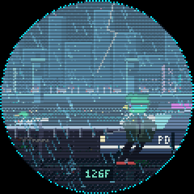 | 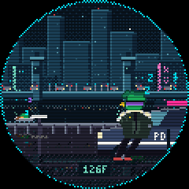 | 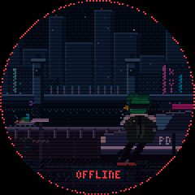 | |

`wth-edge art live-preview --out <dir>` renders these previews from the sample states in
`art/live.py`.

`wth-display.service` plays `display.boot_animation` (default `boot`, `""` for none) once
when it starts, then shows the status screen. Any GIF works with `wth-edge play`, including
ones drawn in Aseprite at 80x80 or 120x120: smaller frames are scaled up with nearest
neighbour. On a laptop, `play` writes frames to `dev/display.png`.

### Weather

`[weather] enabled = true` (on in the Pi 5 profile) polls [Open-Meteo](https://open-meteo.com)
(free, no key) every `interval_s` (900) for the bridge's location (`site.bridge_lat` /
`bridge_lon`, or `weather.lat` / `lon`) and writes the sample to `state.json` as `weather`:
`kind` (clear, cloudy, fog, rain, heavy_rain, snow, thunderstorm), `precipitation_mm`,
`visibility_m`, `temperature_c`, `wind_kmh`, `is_day`, and `low_visibility` when visibility
is under `lowvis_below_m` (1000). The screen draws the weather; `low_visibility` is there for
the detectors to lean on when the camera can't see the far bank (not wired in yet). Without
coordinates the source stays off with a warning in the log.

## Status

Done: install script, profiles, camera service with health checks, status screen,
telemetry, console and Firestore publishers, the web panel (live view, telemetry, map), manual recording
with pre-roll, the clip browser, drag-to-adjust ROIs, dataset import and replay, leaf,
traffic and boat detectors, the opening state machine with wait estimates, the AIS feed,
auto-recording with detection logs, and `eval`.

Next, per the plan: the accuracy gate (shadow mode, labels, scoring), the daily rollup in
Firestore, then H.264 streaming through MediaMTX. The
bridge detector is the weak spot; once the Pi has collected labelled clips, a small
classifier on the bridge box should replace the Hough angle.
